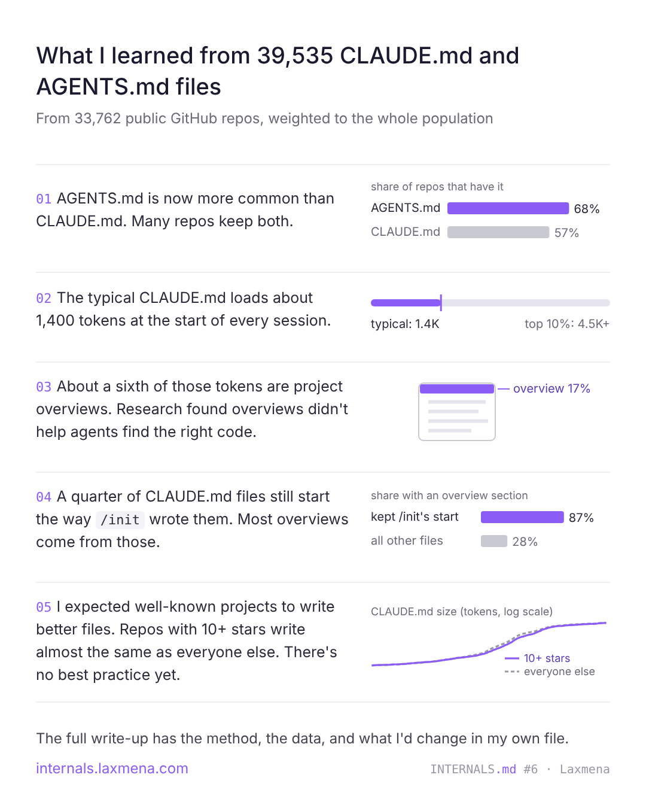

# neri (நெறி): a census of CLAUDE.md and AGENTS.md files

Coding agents read a plain-text instruction file at the start of every session: `CLAUDE.md` for Claude Code, `AGENTS.md` for many
other tools. Millions of these files sit in public GitHub repos and almost nobody has looked at them as a whole. neri measured them:
33,762 public repos (39,535 files), weighted back to the whole population, including the small personal repos that make up about
nine in ten of it. It counts what people wrote (size, structure, what fills the file, what sits next to it). It does not measure
whether any instruction works.



- **Read the write-up:** https://internals.laxmena.com/p/what-i-found-in-39535-claudemd-and
- **Explore the data interactively:** https://concepts.laxmena.com/concepts/claude-md-census/
- **Data for the interactive page** (aggregates only): [`site-data/`](site-data/) (see `site-data/schema.md`)
- **Dataset:** [`data/public/`](data/public/) (frozen pointer list + derived features; no third-party text)
- **Methods, limits and validation:** [`docs/METHODS.md`](docs/METHODS.md)

## Headline findings

All numbers are weighted estimates from [`reports/numbers.json`](reports/numbers.json) (95% intervals there).

1. **AGENTS.md is now more common than CLAUDE.md, and many repos keep both.** 68% of repos with an agent file have an AGENTS.md, 57% a CLAUDE.md.
2. **The typical CLAUDE.md loads about 1,400 tokens at the start of every session** (median 1,379; the top 10% load over 4,400).
3. **About a sixth of those tokens are project overviews** (17% of CLAUDE.md tokens). A published study found overviews did not help agents find the right files.
4. **A quarter of CLAUDE.md files still start the way `/init` wrote them** (26% contain the stock opening sentence), and most overview sections sit in those files: 87% have an overview section, against 28% of all other files.
5. **Well-known projects write almost the same files as everyone else.** The median CLAUDE.md is about 1,550 tokens in repos with 10+ stars and about 1,360 in smaller ones. There is no visible best practice yet.

## Reproduce it

Snapshot date `2026-11-15`, seed `20261115` (both in `config.toml`; hashes of the frozen inputs are in `data/public/FROZEN.json`).
Start from the frozen candidate pointer list (100,395 candidate files in 89,051 repos) and go to `reports/numbers.json`:

```bash
uv sync
uv run neri env                                    # GitHub auth + rate limits (token from `gh auth token`; never logged)
mkdir -p data/raw && cp data/public/candidates-frozen.parquet data/raw/candidates.parquet
uv run neri sample                                 # split (hash of owner/repo), metadata, filters, strata
uv run neri strata                                 # non-dev population sizes per stratum
uv run neri longtail && uv run neri longtail-boost # small repos (0-9 stars): measure every eligible repo
uv run neri popular-full                           # popular repos (10+ stars): measure every eligible repo
uv run neri fetch                                  # trees, agent files, imports at pinned shas (raw.githubusercontent.com)
uv run neri fetch-readmes && uv run neri fetch-settings
uv run neri features                               # deterministic features, no LLM
uv run neri extras                                 # README overlap, link classes, settings, signature, hooks, co-presence
uv run neri report                                 # reports/numbers.json: weighted estimates, bootstrap CIs clustered by repo
uv run pytest -q
```

Needs a GitHub token (`gh auth login`), a few hours of API quota, and about 2 GB of disk for fetched files. I ran the first step
(`neri env`) and the test suite in this clean export; the downstream stages were run in the original working copy, and a full
fresh run from the frozen list has not been repeated.

**What you cannot reproduce:** the code-search enumeration that produced the candidate list. GitHub code search returns different
results over time, caps each query at 1,000 hits (so the enumeration partitions by file size), and indexes only default branches.
That is why the pointer list is frozen and published. Also not reproducible: repo contents after the snapshot (fetches use pinned
shas, so they are stable unless a repo is deleted or made private), the second-labeler runs on OpenRouter (model and date are in
`docs/METHODS.md`), and GitHub's repository-search totals used for the age baseline.

## Scope and limits

This covers **public, committed, shared instruction files**: not private repos, personal or global files, `CLAUDE.local.md`, or
uncommitted settings. It sees only what GitHub code search returns (default branches, no forks or archived repos, recently active
repos). Tokens use an open tokenizer as a proxy for Claude's. Several detectors were dropped after hand validation (package-manager
mismatch, instruction "smells", ALL-CAPS emphasis); see [`docs/METHODS.md`](docs/METHODS.md).

## License

- **Code: MIT** (see [`LICENSE`](LICENSE))
- **Data (`data/public/`, figures, derived numbers and figure tables): CC BY 4.0** (see [`data/public/LICENSE`](data/public/LICENSE); attribution: Lakshmanan Meiyappan, "neri"). The pointers only
  reference third-party repositories, which keep their own licenses. No third-party file text is included.

---

By **Laxmena**. A personal hobby project.
